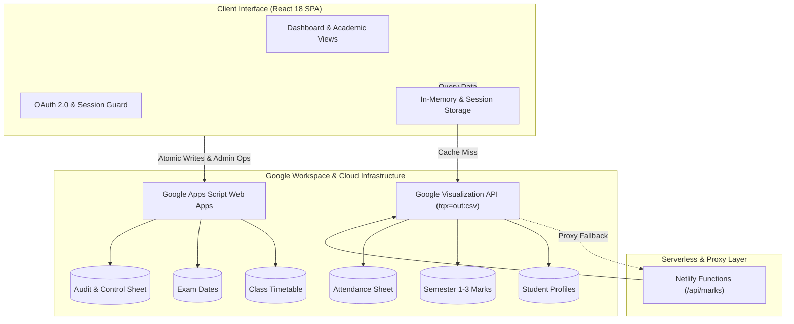

<div align="center">

# 🎓 Student Portal & Institutional Control Center
### Modern Academic Performance Tracking, Attendance Intelligence & Administrative Audit Platform

[](https://react.dev/)
[](https://www.typescriptlang.org/)
[](https://vitejs.dev/)
[](https://tailwindcss.com/)
[](https://cloud.google.com/)
[](https://www.netlify.com/)

<p align="center">
  A serverless, high-performance web platform utilizing Google Sheets as a real-time headless database with atomic Google Apps Script two-way sync, OAuth 2.0 institutional domain gating, and comprehensive academic analytics.
</p>

[📚 Architecture](docs/ARCHITECTURE.md) •
[⚙️ Setup Guide](docs/SETUP_GUIDE.md) •
[📑 Sheets Schema](docs/GOOGLE_SHEETS_SCHEMA.md) •
[🛡️ Admin Handbook](docs/ADMIN_GUIDE.md) •
[📡 API Reference](docs/API_AND_SCRIPTS.md)

---

</div>

## 📑 Table of Contents

- [🌟 Key Highlights](#-key-highlights)
- [✨ Feature Matrix](#-feature-matrix)
  - [👨‍🎓 Student Portal Experience](#-student-portal-experience)
  - [🛡️ Institutional Control Center (Admin)](#️-institutional-control-center-admin)
- [🏗️ Architectural Architecture](#️-architectural-architecture)
- [🛠️ Technology Stack](#️-technology-stack)
- [📂 Repository Directory Structure](#-repository-directory-structure)
- [🚀 Quick Start & Installation](#-quick-start--installation)
- [⚙️ Environment Variables](#️-environment-variables)
- [📖 Detailed Documentation](#-detailed-documentation)
- [📄 License & Authorship](#-license--authorship)

---

## 🌟 Key Highlights

- **Headless Google Sheets Database**: Eliminates relational database hosting costs; allows faculty to maintain records directly in Google Drive.
- **Strict Domain & Roster Whitelist**: Enforces OAuth 2.0 verification against enrolled student records (`@sbjit.edu.in`), denying unrecognized accounts.
- **Two-Way Synchronization**: Direct bidirectional sync using Google Apps Script Web Apps for emergency lockouts, weekly timetables, exam schedules, and audit logging.
- **Multi-Level High-Availability Caching**: In-memory `Map` and `sessionStorage` caching paired with an edge Netlify serverless proxy fallback.
- **Premium User Experience**: Interactive Google Stitch glowing particle grid background, fluid dark/light themes, smooth micro-animations, and mobile dock navigation.

---

## ✨ Feature Matrix

### 👨‍🎓 Student Portal Experience

| Feature | Description |
|---|---|
| **Google Single Sign-On** | Seamless OAuth 2.0 JWT verification strictly against official college emails (`@sbjit.edu.in`). |
| **Academic Performance Analytics** | Semester 1, 2, and 3 marks breakdown, assessment scores (CAE-1, CAE-2, TA, ESE), credits, and SGPA calculation. |
| **Attendance Intelligence** | Real-time lecture attendance metrics with color-coded status badges (🟢 Safe $\ge 75\%$, 🟡 Warning $65-74\%$, 🔴 Critical $< 65\%$). |
| **Elective Course Tracks** | Automatic resolution of Multidisciplinary Minor (MDM) and Open Elective (OE) course tracks by student USN. |
| **Downloadable Grade Statements** | Official printable marksheet generator featuring institutional headers, QR verification codes, and security watermarks. |
| **Interactive Weekly Timetable** | Day-by-day class schedule with live lecture period highlighting, instructor details, room numbers, and theory/lab tags. |
| **Examination Timetable** | Filterable schedule for CAE-1, CAE-2, and ESE with upcoming countdown badges and exam hall locations. |
| **Student Profile & Correction Requests** | Comprehensive student record overview with in-app ticket submission to rectify personal or academic discrepancies. |
| **Security & Session Guard** | 30-minute auto-expiry security timer with live visual countdown and cache management. |

### 🛡️ Institutional Control Center (Admin)

| Capability | Description |
|---|---|
| **Role-Gated Access** | Biometric-like OAuth 2.0 login restricted to authorized administrator email addresses (`/admin`). |
| **Real-Time Audit Trail** | Instantaneous logging of all authentication events, timestamps, IP/device signatures, and failure diagnostics. |
| **Emergency System Lock** | One-click maintenance lock toggle with custom broadcast message displayed across all student portals. |
| **Student Profile Inspection** | Search and inspect any enrolled student profile from the administrator dashboard with a persistent return banner. |
| **Correction Ticket Management** | In-app review workflow to approve or reject student-submitted record modification requests. |
| **Visual Timetable Schedule Editor** | Interactive weekly schedule editor with direct two-way sync to the master Timetable Google Sheet. |
| **Exam Date Scheduler** | Add or delete semester test dates with instant synchronization to the Exam Dates Google Sheet. |

---

## 🏗️ Architectural Architecture



---

## 🛠️ Technology Stack

- **Frontend Core**: [React 18](https://react.dev/), [TypeScript 5.7](https://www.typescriptlang.org/), [Vite 6](https://vitejs.dev/)
- **Styling & Icons**: [Tailwind CSS 3.4](https://tailwindcss.com/), [Lucide React](https://lucide.dev/)
- **Authentication**: [Google Identity Services](https://developers.google.com/identity/gsi/web) (`@react-oauth/google`)
- **Backend & APIs**: [Google Apps Script](https://developers.google.com/apps-script) (V8 Engine), [Netlify Functions](https://www.netlify.com/products/functions/)
- **Data Store**: Google Spreadsheets (Headless CSV GViz API)
- **Deployment**: [Netlify](https://www.netlify.com/)

---

## 📂 Repository Directory Structure

```text
Student-Portal/
├── docs/                             # Comprehensive technical documentation
│   ├── ARCHITECTURE.md               # System design, data pipelines & security
│   ├── SETUP_GUIDE.md                # Local setup, Google OAuth & Apps Script deploy
│   ├── GOOGLE_SHEETS_SCHEMA.md       # Exact column-by-column sheet schemas
│   ├── ADMIN_GUIDE.md                # Institutional Control Center operator manual
│   └── API_AND_SCRIPTS.md            # Apps Script & Netlify function references
├── google-apps-script/               # Backend Google Apps Script source files
│   ├── Code.gs                       # Admin audit log, change requests & lock API
│   ├── ExamDatesSheet.gs             # Exam dates read/write API
│   └── TimetableSheet.gs             # Timetable schedule read/write API
├── netlify/                          # Netlify serverless functions
│   └── functions/
│       └── marks.ts                  # Edge CORS CSV proxy with caching
├── public/                           # Static assets, favicon, & Netlify redirects
│   ├── favicon.svg
│   └── _redirects
├── src/
│   ├── components/                   # Reusable UI, layout & marks components
│   │   ├── common/                   # Backgrounds, loading states, error screens
│   │   ├── layout/                   # Header banners, bottom nav, footer
│   │   ├── marks/                    # Marksheet tables, selectors, download modal
│   │   └── ui/                       # Buttons, cards, modals, toasts
│   ├── config/                       # Sheet ID configs & elective allocations
│   ├── context/                      # AuthContext & ThemeContext
│   ├── pages/                        # View pages: Admin, Marks, Attendance, etc.
│   ├── services/                     # Business logic, sheet parsers & API clients
│   ├── types/                        # TypeScript type definitions
│   ├── utils/                        # Color mappings, storage cleaners, constants
│   ├── App.tsx                       # Root routing, route guards & app shell
│   └── main.tsx                      # Vite React entry point
├── .env.example                      # Template environment variable file
├── netlify.toml                      # Netlify build configuration
├── package.json                      # Project dependencies & npm scripts
└── vite.config.ts                    # Vite build configuration
```

---

## 🚀 Quick Start & Installation

### 1. Clone & Install
```bash
git clone https://github.com/AniketSonwane/Student-Portal.git
cd "Student-Portal"
npm install
```

### 2. Configure Environment
```bash
cp .env.example .env
```
Fill in your Google OAuth Client ID and Google Spreadsheet IDs in `.env`.

### 3. Start Development Server
```bash
npm run dev
```
Visit `http://localhost:5173` in your browser.

### 4. Build for Production
```bash
npm run build
npm run preview
```

---

## ⚙️ Environment Variables

A complete `.env.example` file is provided in the repository root:

| Key | Description |
|---|---|
| `VITE_GOOGLE_CLIENT_ID` | Google OAuth 2.0 Web Application Client ID |
| `VITE_GOOGLE_SHEETS_PROFILE_ID` | Student master profiles spreadsheet ID |
| `VITE_GOOGLE_SHEETS_SEM1_ID` | Semester 1 examination marks spreadsheet ID |
| `VITE_GOOGLE_SHEETS_SEM2_ID` | Semester 2 examination marks spreadsheet ID |
| `VITE_GOOGLE_SHEETS_SEM3_ID` | Semester 3 examination marks spreadsheet ID |
| `VITE_GOOGLE_SHEETS_ATTENDANCE_ID` | Student lecture attendance spreadsheet ID |
| `VITE_GOOGLE_SHEETS_EXAM_DATES_ID` | Examination timetable spreadsheet ID |
| `VITE_GOOGLE_SHEETS_TIMETABLE_ID` | Weekly class timetable spreadsheet ID |
| `VITE_GOOGLE_SHEETS_ADMIN_ID` | Admin audit log & control spreadsheet ID |
| `VITE_GOOGLE_SHEETS_ADMIN_API_URL` | Apps Script Web App URL for Admin (`Code.gs`) |
| `VITE_GOOGLE_SHEETS_TIMETABLE_API_URL` | Apps Script Web App URL for Timetable (`TimetableSheet.gs`) |
| `VITE_GOOGLE_SHEETS_EXAM_DATES_API_URL` | Apps Script Web App URL for Exams (`ExamDatesSheet.gs`) |
| `VITE_ADMIN_EMAIL` | Authorized administrator Google account email |

---

## 📖 Detailed Documentation

Dive deeper into specific areas of the application:

- [🏗️ **System Architecture & Design**](docs/ARCHITECTURE.md): Multi-tier caching, security pipelines, and component hierarchy.
- [🛠️ **Installation & Deployment Guide**](docs/SETUP_GUIDE.md): Google Cloud OAuth setup, sheet sharing, and Netlify hosting.
- [📑 **Google Sheets Schema Reference**](docs/GOOGLE_SHEETS_SCHEMA.md): Complete column-by-column breakdown for every spreadsheet.
- [🛡️ **Administrator Manual**](docs/ADMIN_GUIDE.md): Operational guide for audit logs, maintenance lockout, and student inspection mode.
- [📡 **APIs & Serverless Scripts Reference**](docs/API_AND_SCRIPTS.md): Apps Script handlers, Netlify proxies, and JSON contracts.

---

## 📄 License & Authorship

Developed for institutional academic management and student performance intelligence.  
**All rights reserved © 2026 Aniket Sonwane.**
