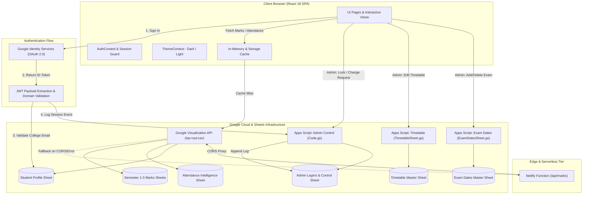

# 🏗️ System Architecture & Engineering Design

This document details the architectural principles, component interactions, data flow, and security mechanisms powering the **Student Portal & Institutional Control Center**.

---

## 📌 Executive Summary

The Student Portal is engineered as a **serverless, high-reliability academic management platform**. Instead of relying on a traditional relational database server with ongoing compute and maintenance costs, the application leverages **Google Sheets as a resilient, real-time headless database** paired with **Google Apps Script** for atomic transactional writes, and **Netlify Serverless Functions** for edge caching and proxy fallback.

```
┌────────────────────────────────────────────────────────────────────────┐
│                              CLIENT BROWSER                            │
│  React 18 + TypeScript + Vite + Tailwind CSS + Lucide Icons            │
└──────────────────┬───────────────────────────────┬─────────────────────┘
                   │                               │
        Read Queries (CSV GViz)             Atomic Writes (JSON POST)
                   │                               │
                   ▼                               ▼
┌──────────────────────────────────────┐  ┌──────────────────────────────┐
│       DATA RETRIEVAL PIPELINE        │  │     TRANSACTION PIPELINE     │
│  1. In-Memory Map Cache             │  │  1. Google Apps Script Web   │
│  2. SessionStorage Cache             │  │     Apps (Code.gs, etc.)     │
│  3. Direct Google GViz CSV Query     │  │  2. Audit Logging            │
│  4. Netlify Proxy Function Fallback  │  │  3. Timetable & Exam Sync    │
└──────────────────┬───────────────────┘  │  4. Change Requests Approvals│
                   │                      └──────────────┬───────────────┘
                   ▼                                     ▼
┌────────────────────────────────────────────────────────────────────────┐
│                        GOOGLE WORKSPACE BACKEND                        │
│  • Enrolled Student Records (Profile Sheet)                            │
│  • Academic Examinations (Sem 1, Sem 2, Sem 3 Sheets)                 │
│  • Attendance Intelligence Sheet                                       │
│  • Weekly Timetable Master Sheet                                       │
│  • Exam Timetable Master Sheet                                         │
│  • Institutional Control Sheet (Logins, Settings, ChangeRequests)      │
└────────────────────────────────────────────────────────────────────────┘
```

---

## 🔄 End-to-End Architecture Diagram



---

## 📊 Core Architectural Tenets

### 1. Headless Google Sheets as a Database
- **Zero Database Maintenance**: No RDS, PostgreSQL, or MongoDB instance to provision, monitor, or patch.
- **Institutional Administrative Familiarity**: Faculty and administrators can directly view and edit data using familiar Google Sheets spreadsheets.
- **Real-Time Data Propagation**: Once a grade, lecture attendance record, or profile detail is entered into Google Sheets, it is immediately accessible to students upon cache invalidation or refresh.

### 2. Multi-Tier High-Availability Read Pipeline
When querying academic marks, attendance, or profiles, the application executes a layered fallback strategy:
1. **Tier 1 (In-Memory `Map<number, T>` Cache)**: Instantaneous lookups with zero network requests for already fetched datasets within the current navigation session.
2. **Tier 2 (`sessionStorage` Persistent Cache)**: Preserves data across page reloads during the active browser session.
3. **Tier 3 (Direct Google Visualization API `tqx=out:csv`)**: Blazing fast binary CSV stream directly from Google's high-speed CDN.
4. **Tier 4 (Netlify Serverless Function Proxy Fallback)**: If client network filters, browser ad-blockers, or CORS restrictions block direct Google endpoints, requests seamlessly fall back to `/.netlify/functions/marks`, which fetches the sheet server-to-server.

### 3. Bidirectional Sync with Google Apps Script
For write-heavy and administrative operations, Google Apps Script functions act as atomic serverless endpoints:
- **Audit Logging**: Appends login attempts, timestamps, device user-agents, and statuses (`SUCCESS`, `DENIED`, `BLOCKED`) to the `Logins` tab.
- **Change Requests**: Stores student discrepancy reports for marks, attendance, and personal records in the `ChangeRequests` tab.
- **Emergency Lock**: Updates system lock states in the `Settings` tab in under 500ms.
- **Schedule Management**: Full semester timetable updates and exam date creation/deletion with automatic schema preservation.

---

## 🔐 Security & Identity Architecture

### 1. Google OAuth 2.0 & Token Parsing
Authentication is managed via `@react-oauth/google`. The client receives an OAuth 2.0 JSON Web Token (JWT) directly from Google's Identity Service:
```typescript
// Header.Payload.Signature decoding
const parts = credential.split('.');
const payload = JSON.parse(atob(parts[1].replace(/-/g, '+').replace(/_/g, '/')));
```

### 2. Strict Domain & Student Whitelist Enforcement
Access is gated at two security checkpoints:
1. **Domain Verification**: Emails must strictly match the authorized institutional domain pattern (`@sbjit.edu.in` or `@sbit.edu.in`).
2. **Directory Matching**: The incoming email is cross-referenced with the enrolled students list in the `Profile` Google Sheet. If an unrecognized email attempts login, the portal returns `Access Denied` and writes a `DENIED` audit log.

### 3. Session Lifecycle & Inactivity Guard
- **Strict 30-Minute Expiry**: Sessions are governed by `authService.SESSION_DURATION_MS = 30 * 60 * 1000`.
- **Live Countdown Timer**: Displayed in the Settings and user status modals, warning users of upcoming expiration.
- **Auto-Logout**: Clears cached authentication states from `localStorage` once the expiration window is reached.

### 4. Admin Role & Inspection Mechanism
- **Dedicated Admin Authentication**: Administrators log in using authorized accounts designated in `VITE_ADMIN_EMAIL` and `VITE_ADMIN_EMAILS`.
- **Student Inspection Mode**: Administrators can simulate and inspect the exact student portal experience for any registered USN.
- **Persistent Return Banner**: When in inspection mode, an elevated banner (`AdminInspectionBanner`) remains fixed at the top of the viewport, enabling instantaneous return to `/admin`.
- **Emergency Lock Override**: Even when the portal is placed into emergency lock mode, administrators bypass lockout restrictions to manage the platform.

---

## 🗂️ Frontend Component Hierarchy & Routes

```text
src/
├── App.tsx                     # Top-level Router, AuthGuard & PublicRoute wrappers
├── context/
│   ├── AuthContext.tsx         # User authentication, session expiration, portal lock state
│   └── ThemeContext.tsx        # Dark / Light theme state and persistent storage
├── pages/
│   ├── Login/                  # Google One-Tap & standard OAuth Sign-In
│   ├── Dashboard/              # Primary landing hub: Quick stats, SGPA, attendance widget
│   ├── Marks/                  # Semester 1-3 marks breakdown, credits, assessment tables
│   ├── Statement/              # Formal printable institutional grade sheet generator
│   ├── Attendance/             # Real-time attendance percentage, status badges, elective tracks
│   ├── ExamDates/              # Filterable exam schedules, upcoming countdowns, room venues
│   ├── Timetable/              # Interactive weekly timetable with live lecture indicator
│   ├── Profile/                # Comprehensive personal information & record correction form
│   ├── Settings/               # Theme preferences, session timer, storage manager
│   ├── Terms/                  # Privacy policy and institutional usage terms
│   └── Admin/                  # Institutional Control Center (Logs, Lock, Schedule editors)
├── services/
│   ├── auth.ts                 # Token decoding, verification, session time checks
│   ├── adminSheetService.ts    # Apps Script client for logs, change requests, system lock
│   ├── marks.ts                # Semester marks queries, caching, subject resolution
│   ├── sheetParser.ts          # RFC-4180 CSV parser, grade calculators, honors resolver
│   ├── attendance.ts           # Attendance parser, elective allocator (MDM / OE)
│   ├── examDates.ts            # Exam scheduler parser & date normalizer
│   ├── timetable.ts            # Week schedule parser & live period detector
│   └── profile.ts              # Student directory parser & search engine
└── utils/
    ├── cleanStorage.ts         # Pruning stale data and legacy storage keys
    ├── constants.ts            # App metadata and route URLs
    └── subjectColors.ts        # Color mapping utilities for subject badges
```

---

## ⚡ Performance Optimizations

1. **Sub-second Initial Load**: Zero heavy external component libraries; minimal bundle size powered by Tailwind CSS purging and Vite code-splitting.
2. **Parallel Prefetching**: When authenticating, user profile verification and live system settings are fetched concurrently using `Promise.all([adminSheetService.fetchLiveSettings(), profileService.fetchAllStudents()])`.
3. **Optimized CSV Streaming**: Google Visualization exports data in raw text CSV rather than verbose JSON, saving up to 80% bandwidth on large marksheets.
4. **Intelligent Caching**: In-memory maps prevent repeated network trips when navigating between pages.
